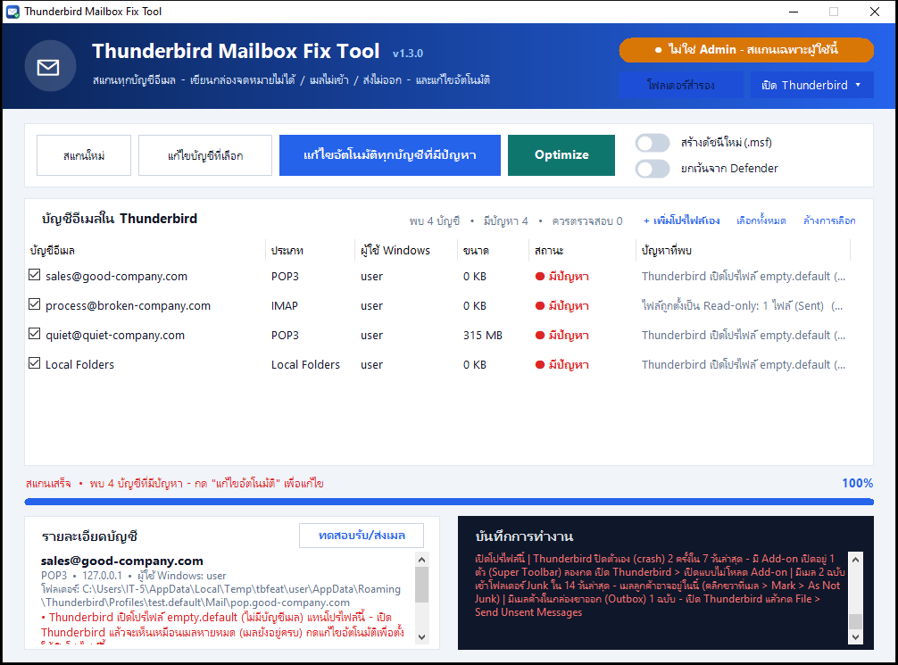

# Thunderbird Mail Fix

โปรแกรมสแกนและแก้ปัญหา **Mozilla Thunderbird** บน Windows แยกตามบัญชีอีเมล มีหน้าต่างใช้งานภาษาไทย
ใช้ได้ทั้งแบบ **ไฟล์ .exe ไฟล์เดียว** (วางบน shared server แล้วดับเบิลคลิก) และแบบสคริปต์ PowerShell

A single-file Windows tool (exe or PowerShell script) that scans every Thunderbird mail account on a PC, fixes the broken ones and optimizes the profile.



## ดาวน์โหลด

ไปที่หน้า [Releases](../../releases/latest) แล้วดาวน์โหลด **`ThunderbirdMailFix.exe`**
ไม่ต้องติดตั้ง ไม่ต้องมีไฟล์อื่นประกอบ

## วิธีใช้งาน

1. ดับเบิลคลิก `ThunderbirdMailFix.exe` แล้วกด **Yes** ที่หน้าต่างขอสิทธิ์ Administrator
   (หรือคลิกขวาที่ `Thunderbird-Fix-Tool.ps1` > **Run with PowerShell**)
2. โปรแกรมจะสแกนทุกบัญชีอีเมลให้อัตโนมัติ
   - 🟢 **ปกติ** – ไม่พบปัญหา
   - 🔴 **มีปัญหา** – เขียนกล่องจดหมายไม่ได้ / เมลไม่เข้า / ส่งไม่ออก (ถูกติ๊กเลือกไว้ให้แล้ว)
   - 🟠 **ควรตรวจสอบ** – ไม่ร้ายแรง แต่ควรดู เช่น เมลค้างใน Outbox
3. คลิกที่บัญชีเพื่อดูรายละเอียดปัญหาในช่อง **รายละเอียดบัญชี**
4. กดปุ่มที่ต้องการ
   - **แก้ไขอัตโนมัติทุกบัญชีที่มีปัญหา** – แก้ทุกบัญชีที่เป็นสีแดง
   - **แก้ไขบัญชีที่เลือก** – แก้เฉพาะบัญชีที่ติ๊กไว้
   - **Optimize** – ปรับแต่งโปรไฟล์ให้ Thunderbird ทำงานเสถียรขึ้น
   - **ทดสอบรับ/ส่งเมล** (ในช่องรายละเอียดบัญชี) – ใช้เมื่อกด Get Messages แล้วรับเมลไม่ได้ หรือส่งเมลไม่ออก ดูหัวข้อด้านล่าง
   - **เปิด Thunderbird ▾** (มุมขวาบน) – เปิดตามปกติ / เปิดแบบไม่โหลด Add-on / เลือกโปรไฟล์ (Profile Manager)
5. เมื่อเสร็จ โปรแกรมจะสแกนซ้ำเพื่อยืนยันผล แล้วเปิด Thunderbird ทดสอบได้เลย
   หากยังมีปัญหาในโฟลเดอร์ใด ให้คลิกขวาที่โฟลเดอร์ > **Properties** > **Repair Folder**

## ปัญหาที่ตรวจพบและแก้ได้

| ปัญหา | ตรวจพบ | แก้อัตโนมัติ |
|---|:-:|:-:|
| "ไม่สามารถเขียนอีเมลไปยังกล่องจดหมายได้" (Unable to write the email to the mailbox) | ✅ | ✅ |
| สิทธิ์โฟลเดอร์ผิด / ผู้ใช้ไม่มีสิทธิ์เขียนไฟล์เมล | ✅ | ✅ |
| ไฟล์เมลเป็น Read-only หรือถูกล็อก | ✅ | ✅ |
| ไฟล์ดัชนีโฟลเดอร์ (.msf) เสีย | ✅ | ✅ |
| ไฟล์ค้างจากการ Compact ที่ล้มเหลว (nstmp) | ✅ | ✅ |
| ไฟล์ล็อกโปรไฟล์ค้าง, ไฟล์ชั่วคราวค้าง | ✅ | ✅ |
| **Thunderbird ค้างอยู่เบื้องหลัง** (เปิด Thunderbird ไม่ขึ้น / ต้องรีสตาร์ทเครื่องถึงจะหาย) | ✅ | ✅ ปิดให้โดยไม่ต้องรีสตาร์ท |
| **เปิด Thunderbird แล้วเมลหายหมด** – Thunderbird ไปเปิดโปรไฟล์ว่าง / profiles.ini ลืมโปรไฟล์ที่มีเมล | ✅ | ✅ ตั้งให้เปิดโปรไฟล์ที่มีเมล |
| **Thunderbird ปิดตัวเอง (crash)** – บอกจำนวนครั้งและ Add-on ที่เปิดอยู่ | ✅ | เปิดแบบไม่โหลด Add-on ให้ |
| **ส่งเมลไม่ออก** – ล็อกอิน SMTP จริง: รหัสผิด / พอร์ตถูกบล็อก / ต้องเข้ารหัส (ปุ่ม **ทดสอบรับ/ส่งเมล**) | ✅ | แจ้งวิธีแก้ |
| ไฟล์เมลถูกโปรแกรมอื่นเปิดค้าง (บอกชื่อโปรแกรม เช่น แอนตี้ไวรัส / Windows Search) | ✅ | แจ้งวิธีแก้ |
| เมลไม่เข้า เพราะปิด "ตรวจเมลใหม่อัตโนมัติ" ไว้ | ✅ | ✅ |
| ไฟล์สถานะ POP3 (popstate.dat) เสีย ทำให้ Thunderbird ข้ามเมลใหม่ | ✅ | ✅ |
| POP3 ลบเมลจากเซิร์ฟเวอร์ (ไม่ได้ติ๊ก Leave messages on server) – เครื่องอื่นดึงเมลไปก่อน | ✅ | แจ้งวิธีแก้ |
| Message Filter ที่ย้าย / ลบ / ส่งเมลเข้า Junk อัตโนมัติ | ✅ | แจ้งวิธีแก้ |
| เมลลูกค้าตกไปอยู่ในโฟลเดอร์ Junk / Spam (นับเมลที่เข้า 14 วันล่าสุด) | ✅ | แจ้งวิธีแก้ |
| เมลถูกเก็บรวมไว้ที่ Local Folders (Global Inbox) | ✅ | แจ้งวิธีแก้ |
| เซิร์ฟเวอร์ POP3 ไม่ตอบ / ใบรับรอง SSL มีปัญหา | ✅ | แจ้งวิธีแก้ |
| รหัสผ่านผิด / กล่องเมลถูกเครื่องอื่นล็อก / เซิร์ฟเวอร์เต็ม (ปุ่ม **ทดสอบรับ/ส่งเมล**) | ✅ | แจ้งวิธีแก้ |
| เชื่อมต่อเซิร์ฟเวอร์รับเมล / ส่งเมลไม่ได้ (DNS, Port, Firewall) | ✅ | แจ้งวิธีแก้ |
| ไม่ได้บันทึกรหัสผ่าน | ✅ | แจ้งวิธีแก้ |
| เมลค้างในกล่องขาออก (Outbox) | ✅ | แจ้งวิธีแก้ |
| กล่องจดหมายใหญ่เกิน 4 GB, ดิสก์เต็ม, ไดรฟ์ FAT32, โปรไฟล์อยู่ใน OneDrive | ✅ | แจ้งวิธีแก้ |
| โฟลเดอร์เก็บเมล (Local Directory) หายไป | ✅ | แจ้งวิธีแก้ |

ปัญหาที่ต้องแก้ที่เซิร์ฟเวอร์หรือเครือข่าย (รหัสผ่านผิด, เซิร์ฟเวอร์ล่ม, Firewall บล็อก) โปรแกรมจะบอกสาเหตุและวิธีแก้ แต่แก้แทนไม่ได้

## เมลไม่เข้า / ส่งไม่ออก / กด Get Messages ไม่ได้

1. **สแกน** – ดูบัญชีที่เป็นสีแดง/ส้ม แล้วคลิกดูรายละเอียด โปรแกรมจะบอกถ้าเมลถูก Filter ย้ายไป, ตก Junk, หรือมีเครื่องอื่นดึงไปก่อน
2. **ทดสอบรับ/ส่งเมล** – เลือกบัญชี กดปุ่ม **ทดสอบรับ/ส่งเมล** แล้วใส่รหัสผ่าน โปรแกรมจะล็อกอินเข้าเซิร์ฟเวอร์รับเมล (POP3) และส่งเมล (SMTP) แบบเดียวกับ Get Messages / Send (ไม่ส่งเมลจริง) และบอกผล:

| ผลที่ได้ | ความหมาย / วิธีแก้ |
|---|---|
| ล็อกอินสำเร็จ – มีเมลรอ N ฉบับ | เซิร์ฟเวอร์ปกติ ปัญหาอยู่ที่ Thunderbird: ลบรหัสผ่านเก่าใน Saved Passwords, ตรวจโหมด Work Offline, กดแก้ไขอัตโนมัติ |
| ล็อกอินสำเร็จ – ไม่มีเมลบนเซิร์ฟเวอร์ | เมลไม่ได้อยู่บนเซิร์ฟเวอร์: เครื่องอื่นดึงไปแล้ว / ตก Spam บนเซิร์ฟเวอร์ / ส่งไม่ถึง (ขอเมลตีกลับจากลูกค้า) |
| รหัสผ่านไม่ถูกต้อง | รหัสหมดอายุหรือถูกเปลี่ยน – ตรวจกับผู้ดูแลเมลเซิร์ฟเวอร์ แล้วอัปเดตใน Thunderbird |
| กล่องเมลถูกเครื่องอื่นใช้งานอยู่ | POP3 ให้เข้าได้ทีละเครื่อง – ปิดโปรแกรมเมลเครื่องอื่น/มือถือ แล้วลองใหม่ |
| เซิร์ฟเวอร์มีปัญหา / พื้นที่เต็ม | ติดต่อผู้ดูแลเมลเซิร์ฟเวอร์ |
| ส่งเมล: รหัสผ่านไม่ถูกต้อง (535) | รหัสผ่าน SMTP ผิด – แก้ที่ Settings > Outgoing Server (SMTP) และลบรหัสเก่าใน Saved Passwords |
| ส่งเมล: เชื่อมต่อไม่ได้ | Firewall / ผู้ให้บริการเน็ตบล็อกพอร์ต – ลองพอร์ต 587 (STARTTLS) หรือ 465 (SSL/TLS) |
| ส่งเมล: ต้องเข้ารหัสก่อนล็อกอิน (530) | ตั้ง Connection security ของ SMTP เป็น STARTTLS หรือ SSL/TLS |

รหัสผ่านที่ใส่ใช้ทดสอบครั้งเดียว **ไม่มีการบันทึก** และไม่ถูกเขียนลงไฟล์ log

## Optimize ทำอะไรบ้าง

| ขั้นตอน | รายละเอียด |
|---|---|
| ตรวจและบีบอัดฐานข้อมูล | ตรวจความเสียหายของไฟล์ฐานข้อมูล (SQLite) ทุกไฟล์ในโปรไฟล์ แล้วบีบอัด (VACUUM) ให้เล็กและเร็วขึ้น |
| ซ่อมฐานข้อมูลที่เสีย | ไฟล์ที่ Thunderbird สร้างใหม่ได้ (เช่น ฐานข้อมูลค้นหา) จะถูกย้ายไปโฟลเดอร์สำรองให้สร้างใหม่ ส่วนไฟล์สำคัญ (สมุดที่อยู่, กุญแจ OpenPGP, ปฏิทิน) **จะไม่ถูกลบ** แค่แจ้งเตือนและเก็บสำเนาไว้ |
| ซ่อมไฟล์ตั้งค่าที่เสีย | ไฟล์ JSON ที่อ่านไม่ได้ (เช่น xulstore.json, folderCache.json) จะถูกย้ายออกให้ Thunderbird สร้างใหม่ |
| ล้างแคช | ลบแคชและไฟล์ชั่วคราวของ Thunderbird |
| เปิด Auto-Compact | ให้ Thunderbird บีบอัดโฟลเดอร์เองอัตโนมัติเมื่อเกิน 20 MB (ลบเมลที่ถูกลบออกจริง ไฟล์ไม่บวม) |
| แจ้งเตือน Trash / Junk | เตือนเมื่อโฟลเดอร์ถังขยะหรือจดหมายขยะใหญ่เกิน 300 MB |

### ตัวเลือกเพิ่มเติม
- **สร้างดัชนีใหม่ (.msf)** – ตอนแก้ไข จะย้ายไฟล์ดัชนีทั้งหมดออกให้ Thunderbird สร้างใหม่ ใช้เมื่อยังพบข้อผิดพลาดซ้ำ
- **ยกเว้นจาก Defender** – เพิ่มโฟลเดอร์โปรไฟล์เป็นข้อยกเว้นของ Windows Defender เมื่อแอนตี้ไวรัสล็อกไฟล์เมล

## หาโปรไฟล์ Thunderbird เจอที่ไหนบ้าง

- ติดตั้งแบบปกติ (`%APPDATA%\Thunderbird`) ของทุกผู้ใช้ในเครื่อง รวมถึงผู้ใช้ที่โปรไฟล์อยู่ไดรฟ์อื่น
- Thunderbird จาก **Microsoft Store**
- ไม่มีไฟล์ `profiles.ini` หรือไฟล์เสีย – ค้นจากโฟลเดอร์ `Profiles` โดยตรง
- โปรไฟล์ที่ย้ายไปไว้ที่อื่น (path แบบเต็ม / มีตัวแปร เช่น `%USERPROFILE%`)
- **Thunderbird Portable** หรือโปรไฟล์ที่อื่น – กด **+ เพิ่มโปรไฟล์เอง** แล้วเลือกโฟลเดอร์

## โปรแกรมเปิดไม่ติด?

| อาการ | v1.2.1 จัดการให้ |
|---|---|
| กด **No** ที่หน้าต่างขอสิทธิ์ Admin แล้วโปรแกรมไม่เปิด | เปิดต่อแบบผู้ใช้ปัจจุบัน (สแกนเฉพาะโปรไฟล์ตัวเอง) |
| เปิดจาก shared server ผ่านไดรฟ์ที่ map ไว้ (เช่น `Z:`) แล้วไม่ขึ้น | เปลี่ยนเป็น path จริง `\\server\share\...` ก่อนขอสิทธิ์ Admin |
| เปิดซ้ำแล้วไม่ขึ้น / ขึ้นว่าเปิดอยู่แล้ว | ดึงหน้าต่างเดิมขึ้นมาให้ ถ้าตัวเดิมค้างอยู่เบื้องหลังจะถามเพื่อปิดตัวที่ค้าง |
| ปิดหน้าต่างแล้วโปรแกรมยังค้างอยู่ในเครื่อง | ปิดโปรแกรมจริงทันที ไม่ค้างเบื้องหลัง |
| เปิดแล้วเงียบ ไม่มีอะไรขึ้น | แสดงข้อความบอกสาเหตุ และบันทึกไว้ที่ `%TEMP%\ThunderbirdMailFix-errors.log` |

ถ้ายังเปิดไม่ได้ ส่วนใหญ่เป็นเพราะแอนตี้ไวรัสบล็อกไฟล์ exe ให้เพิ่ม `ThunderbirdMailFix.exe` เป็นข้อยกเว้น

## ความปลอดภัยของข้อมูล

- **ไม่มีการลบอีเมล** ไฟล์ที่นำออกจากโปรไฟล์จะถูก **ย้าย** ไปที่ `Desktop\Thunderbird-Fix-Backup-<วันเวลา>` พร้อมไฟล์ log
- สำรอง `prefs.js` และฐานข้อมูลสำคัญก่อนแก้ไขทุกครั้ง
- ปิด Thunderbird อย่างถูกวิธีก่อนแก้ไข (รอให้บันทึกไฟล์เสร็จ สูงสุด 15 วินาที) ถ้าปิดไม่ได้จะไม่แก้ไขอะไรเลย
- เปิดโปรแกรมได้ทีละหน้าต่าง ป้องกันการแก้ไฟล์ชนกัน
- รันแบบ Administrator จะสแกนทุกผู้ใช้ Windows ในเครื่อง ถ้าไม่ใช่ Admin จะสแกนเฉพาะผู้ใช้ปัจจุบัน

## Source code

| ไฟล์ | หน้าที่ |
|---|---|
| `Thunderbird-Fix-Tool.ps1` | ตัวโปรแกรมทั้งหมด (หน้าต่าง + ระบบสแกน/แก้ไข/Optimize) |
| `build.ps1` | สร้างไฟล์ `dist\ThunderbirdMailFix.exe` |
| `build/Launcher.cs` | ตัวเปิดโปรแกรมของ exe (ฝังสคริปต์ไว้ข้างในแล้วรันในตัว) |
| `build/app.manifest` | manifest ของ exe (ตัว launcher ขอสิทธิ์ Admin เอง) |
| `build/app.ico` | ไอคอนโปรแกรม |
| `tests/feature-test.ps1` | Dry test ทุกฟีเจอร์ผ่านหน้าต่างจริง (สแกน / แก้ไข / ทดสอบรับ-ส่งเมล / Optimize / เมนู) |
| `tests/launch-test.ps1` | Dry test การเปิดโปรแกรม การหา Thunderbird และกรณีค้าง |

### Dry test

ทดสอบกับโปรไฟล์จำลองเท่านั้น ไม่แตะ Thunderbird จริงในเครื่อง

```powershell
powershell -ExecutionPolicy Bypass -File .\tests\feature-test.ps1
powershell -ExecutionPolicy Bypass -File .\tests\feature-test.ps1 -Build .\build.ps1
powershell -ExecutionPolicy Bypass -File .\tests\launch-test.ps1 -Tool .\Thunderbird-Fix-Tool.ps1 -Root $env:TEMP\tblaunch -ShotDir $env:TEMP -Build .\build.ps1
```

### สร้างไฟล์ .exe เอง

```powershell
powershell -ExecutionPolicy Bypass -File .\build.ps1
```

ใช้ C# compiler ที่มากับ Windows (.NET Framework 4) ไม่ต้องติดตั้งอะไรเพิ่ม เลขเวอร์ชันของ exe อ่านจาก `$AppVersion` ในสคริปต์

- exe ไม่ได้ลงลายเซ็นดิจิทัล Windows SmartScreen หรือแอนตี้ไวรัสบางตัวอาจเตือนครั้งแรก ให้กด "More info > Run anyway" หรือเพิ่มเป็นข้อยกเว้น

## ประวัติเวอร์ชัน

### v1.3.0 – เมลหาย / Thunderbird crash / ส่งไม่ออก
- **เปิด Thunderbird แล้วเมลหายหมด**: ตรวจว่า Thunderbird ไปเปิดโปรไฟล์ว่าง (installs.ini / profiles.ini) แล้วตั้งให้เปิดโปรไฟล์ที่มีเมล – เจอโปรไฟล์แม้ profiles.ini จะไม่ได้ลงไว้แล้ว
- **Thunderbird crash**: นับครั้งที่ปิดตัวเองใน 7 วัน และบอกชื่อ Add-on ที่เปิดอยู่
- ปุ่ม **เปิด Thunderbird ▾**: เปิดตามปกติ / เปิดแบบไม่โหลด Add-on (Troubleshoot Mode) / Profile Manager
- ปุ่ม **ทดสอบรับ/ส่งเมล**: เพิ่มการล็อกอิน SMTP จริง (STARTTLS / SSL, AUTH PLAIN / LOGIN) บอกรหัสผิด / พอร์ตถูกบล็อก / ต้องเข้ารหัส – ไม่ส่งเมลจริง
- เปิดโปรแกรมซ้ำขณะเมนูหรือกล่องข้อความเปิดอยู่ ดึงหน้าต่างเดิมขึ้นมาได้ถูกต้อง

### v1.2.1 – เปิดติดทุกครั้ง หา Thunderbird เจอ ไม่ต้องรีสตาร์ท
- ตรวจและปิด **Thunderbird ที่ค้างอยู่เบื้องหลัง** (ถือล็อกโปรไฟล์ไว้แต่ไม่มีหน้าต่าง / ไม่ตอบสนอง) แทนการรีสตาร์ทเครื่อง
- บอกชื่อโปรแกรมที่เปิดไฟล์เมลค้างไว้ (ใช้ Windows Restart Manager)
- หาโปรไฟล์เจอเพิ่ม: Microsoft Store, ไม่มี profiles.ini, path แบบเต็ม/มีตัวแปร, ปุ่ม **+ เพิ่มโปรไฟล์เอง** สำหรับ Thunderbird Portable
- ปุ่ม **เปิด Thunderbird** หาโปรแกรมจาก Registry, ติดตั้งแบบผู้ใช้เดียว และ Microsoft Store
- exe: กด No ที่ UAC แล้วยังเปิดได้, เปิดจากไดรฟ์ที่ map / SUBST ได้, แสดงข้อความเมื่อเปิดไม่สำเร็จ
- เปิดซ้ำ = ดึงหน้าต่างเดิมขึ้นมา, ตัวเก่าที่ค้างถามเพื่อปิดให้, เปิดซ้อนกับตัวที่เป็น Admin ไม่ error
- ปิดหน้าต่างแล้วโปรแกรมจบจริง (ไม่ค้างเบื้องหลัง), กล่องข้อความไม่ไปซ่อนหลังหน้าต่างอื่น, ไม่ขวางการปิดเครื่อง
- เพิ่ม Dry test อัตโนมัติในโฟลเดอร์ `tests/`

### v1.2.0 – เมลไม่เข้า (POP3)
- เพิ่มปุ่ม **ทดสอบรับเมล**: ล็อกอินเข้าเซิร์ฟเวอร์ POP3 จริง บอกได้ว่ารหัสผิด / กล่องเมลถูกล็อก / เซิร์ฟเวอร์เต็ม / มีเมลรอกี่ฉบับ
- ตรวจและซ่อมไฟล์สถานะ POP3 (popstate.dat) ที่เสีย
- เตือนเมื่อ POP3 ไม่ได้ติ๊ก Leave messages on server (เครื่องอื่นอาจดึงเมลไปก่อน)
- ตรวจ Message Filter ที่ย้าย/ลบเมลอัตโนมัติ
- ตรวจเมลที่ตกไปอยู่ในโฟลเดอร์ Junk ภายใน 14 วันล่าสุด
- ตรวจ Global Inbox, การตอบกลับของเซิร์ฟเวอร์ POP3 และใบรับรอง SSL

### v1.1.0
- เพิ่มปุ่ม **Optimize**: ตรวจ/บีบอัดฐานข้อมูล, ซ่อมไฟล์ตั้งค่าที่เสีย, ล้างแคช, เปิด Auto-Compact, เตือน Trash/Junk ใหญ่
- ปิด Thunderbird อย่างถูกวิธี (รอ 15 วินาทีก่อนบังคับปิด) และไม่แก้ไขอะไรถ้าปิดไม่สำเร็จ
- ป้องกันการเปิดโปรแกรมซ้อนกัน
- ตรวจ DNS แบบมีเวลาจำกัด ไม่ค้างเมื่อเครือข่ายมีปัญหา
- ค้นหาโปรไฟล์ผู้ใช้ได้ทุกไดรฟ์ (ไม่ใช่แค่ C:)
- แก้บั๊กสีในช่องรายละเอียดบัญชี และบั๊กที่ Optimize ไม่ทำงานเมื่อมีโปรไฟล์เดียว
- แสดงเลขเวอร์ชันในหน้าต่าง และใน Properties ของไฟล์ exe

### v1.0.0
- เวอร์ชันแรก: สแกนแยกทีละบัญชี, แก้ไขอัตโนมัติ, ตรวจเครือข่าย/รหัสผ่าน/Outbox, ไฟล์ exe ไฟล์เดียว

## Requirements

- Windows 10 / 11 (มี .NET Framework 4 และ Windows PowerShell 5.1 มาให้แล้ว)
- Mozilla Thunderbird (โปรไฟล์อยู่ใต้ `%APPDATA%\Thunderbird`)

## ผู้พัฒนา

พัฒนาโดย [@tungtrue2518-del](https://github.com/tungtrue2518-del)
พบปัญหาหรือมีข้อเสนอแนะ เปิด [Issue](../../issues) ได้เลย

## License

[MIT](LICENSE) – ใช้งาน แก้ไข และแจกจ่ายต่อได้ฟรี

> โปรแกรมนี้ไม่ได้เป็นผลิตภัณฑ์ของ Mozilla และไม่ได้รับการรับรองจาก Mozilla
> "Thunderbird" เป็นเครื่องหมายการค้าของ Mozilla Foundation
