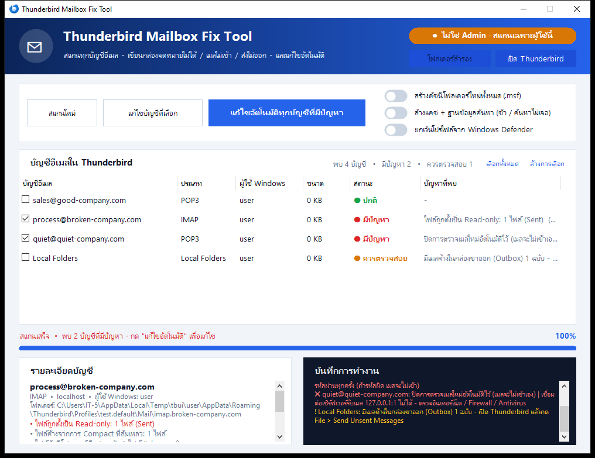

# Thunderbird Mail Fix

โปรแกรมสแกนและแก้ปัญหา **Mozilla Thunderbird** บน Windows แยกตามบัญชีอีเมล มีหน้าต่างใช้งานภาษาไทย
ใช้ได้ทั้งแบบ **ไฟล์ .exe ไฟล์เดียว** (วางบน shared server แล้วดับเบิลคลิก) และแบบสคริปต์ PowerShell

A single-file Windows tool (exe or PowerShell script) that scans every Thunderbird mail account on a PC, fixes the broken ones and optimizes the profile.



## ดาวน์โหลด

ไปที่หน้า [Releases](../../releases/latest) แล้วดาวน์โหลด **`ThunderbirdMailFix.exe`**
ไม่ต้องติดตั้ง ไม่ต้องมีไฟล์อื่นประกอบ

## วิธีใช้งาน

1. ดับเบิลคลิก `ThunderbirdMailFix.exe` แล้วกด **Yes** ที่หน้าต่างขอสิทธิ์ Administrator
   (หรือคลิกขวาที่ `Thunderbird-Fix-Tool.ps1` > **Run with PowerShell**)
2. โปรแกรมจะสแกนทุกบัญชีอีเมลให้อัตโนมัติ
   - 🟢 **ปกติ** – ไม่พบปัญหา
   - 🔴 **มีปัญหา** – เขียนกล่องจดหมายไม่ได้ / เมลไม่เข้า / ส่งไม่ออก (ถูกติ๊กเลือกไว้ให้แล้ว)
   - 🟠 **ควรตรวจสอบ** – ไม่ร้ายแรง แต่ควรดู เช่น เมลค้างใน Outbox
3. คลิกที่บัญชีเพื่อดูรายละเอียดปัญหาในช่อง **รายละเอียดบัญชี**
4. กดปุ่มที่ต้องการ
   - **แก้ไขอัตโนมัติทุกบัญชีที่มีปัญหา** – แก้ทุกบัญชีที่เป็นสีแดง
   - **แก้ไขบัญชีที่เลือก** – แก้เฉพาะบัญชีที่ติ๊กไว้
   - **Optimize** – ปรับแต่งโปรไฟล์ให้ Thunderbird ทำงานเสถียรขึ้น
5. เมื่อเสร็จ โปรแกรมจะสแกนซ้ำเพื่อยืนยันผล แล้วเปิด Thunderbird ทดสอบได้เลย
   หากยังมีปัญหาในโฟลเดอร์ใด ให้คลิกขวาที่โฟลเดอร์ > **Properties** > **Repair Folder**

## ปัญหาที่ตรวจพบและแก้ได้

| ปัญหา | ตรวจพบ | แก้อัตโนมัติ |
|---|:-:|:-:|
| "ไม่สามารถเขียนอีเมลไปยังกล่องจดหมายได้" (Unable to write the email to the mailbox) | ✅ | ✅ |
| สิทธิ์โฟลเดอร์ผิด / ผู้ใช้ไม่มีสิทธิ์เขียนไฟล์เมล | ✅ | ✅ |
| ไฟล์เมลเป็น Read-only หรือถูกล็อก | ✅ | ✅ |
| ไฟล์ดัชนีโฟลเดอร์ (.msf) เสีย | ✅ | ✅ |
| ไฟล์ค้างจากการ Compact ที่ล้มเหลว (nstmp) | ✅ | ✅ |
| ไฟล์ล็อกโปรไฟล์ค้าง, ไฟล์ชั่วคราวค้าง | ✅ | ✅ |
| เมลไม่เข้า เพราะปิด "ตรวจเมลใหม่อัตโนมัติ" ไว้ | ✅ | ✅ |
| เชื่อมต่อเซิร์ฟเวอร์รับเมล / ส่งเมลไม่ได้ (DNS, Port, Firewall) | ✅ | แจ้งวิธีแก้ |
| ไม่ได้บันทึกรหัสผ่าน | ✅ | แจ้งวิธีแก้ |
| เมลค้างในกล่องขาออก (Outbox) | ✅ | แจ้งวิธีแก้ |
| กล่องจดหมายใหญ่เกิน 4 GB, ดิสก์เต็ม, ไดรฟ์ FAT32, โปรไฟล์อยู่ใน OneDrive | ✅ | แจ้งวิธีแก้ |
| โฟลเดอร์เก็บเมล (Local Directory) หายไป | ✅ | แจ้งวิธีแก้ |

ปัญหาที่ต้องแก้ที่เซิร์ฟเวอร์หรือเครือข่าย (รหัสผ่านผิด, เซิร์ฟเวอร์ล่ม, Firewall บล็อก) โปรแกรมจะบอกสาเหตุและวิธีแก้ แต่แก้แทนไม่ได้

## Optimize ทำอะไรบ้าง

| ขั้นตอน | รายละเอียด |
|---|---|
| ตรวจและบีบอัดฐานข้อมูล | ตรวจความเสียหายของไฟล์ฐานข้อมูล (SQLite) ทุกไฟล์ในโปรไฟล์ แล้วบีบอัด (VACUUM) ให้เล็กและเร็วขึ้น |
| ซ่อมฐานข้อมูลที่เสีย | ไฟล์ที่ Thunderbird สร้างใหม่ได้ (เช่น ฐานข้อมูลค้นหา) จะถูกย้ายไปโฟลเดอร์สำรองให้สร้างใหม่ ส่วนไฟล์สำคัญ (สมุดที่อยู่, กุญแจ OpenPGP, ปฏิทิน) **จะไม่ถูกลบ** แค่แจ้งเตือนและเก็บสำเนาไว้ |
| ซ่อมไฟล์ตั้งค่าที่เสีย | ไฟล์ JSON ที่อ่านไม่ได้ (เช่น xulstore.json, folderCache.json) จะถูกย้ายออกให้ Thunderbird สร้างใหม่ |
| ล้างแคช | ลบแคชและไฟล์ชั่วคราวของ Thunderbird |
| เปิด Auto-Compact | ให้ Thunderbird บีบอัดโฟลเดอร์เองอัตโนมัติเมื่อเกิน 20 MB (ลบเมลที่ถูกลบออกจริง ไฟล์ไม่บวม) |
| แจ้งเตือน Trash / Junk | เตือนเมื่อโฟลเดอร์ถังขยะหรือจดหมายขยะใหญ่เกิน 300 MB |

### ตัวเลือกเพิ่มเติม
- **สร้างดัชนีใหม่ (.msf)** – ตอนแก้ไข จะย้ายไฟล์ดัชนีทั้งหมดออกให้ Thunderbird สร้างใหม่ ใช้เมื่อยังพบข้อผิดพลาดซ้ำ
- **ยกเว้นจาก Defender** – เพิ่มโฟลเดอร์โปรไฟล์เป็นข้อยกเว้นของ Windows Defender เมื่อแอนตี้ไวรัสล็อกไฟล์เมล

## ความปลอดภัยของข้อมูล

- **ไม่มีการลบอีเมล** ไฟล์ที่นำออกจากโปรไฟล์จะถูก **ย้าย** ไปที่ `Desktop\Thunderbird-Fix-Backup-<วันเวลา>` พร้อมไฟล์ log
- สำรอง `prefs.js` และฐานข้อมูลสำคัญก่อนแก้ไขทุกครั้ง
- ปิด Thunderbird อย่างถูกวิธีก่อนแก้ไข (รอให้บันทึกไฟล์เสร็จ สูงสุด 15 วินาที) ถ้าปิดไม่ได้จะไม่แก้ไขอะไรเลย
- เปิดโปรแกรมได้ทีละหน้าต่าง ป้องกันการแก้ไฟล์ชนกัน
- รันแบบ Administrator จะสแกนทุกผู้ใช้ Windows ในเครื่อง ถ้าไม่ใช่ Admin จะสแกนเฉพาะผู้ใช้ปัจจุบัน

## Source code

| ไฟล์ | หน้าที่ |
|---|---|
| `Thunderbird-Fix-Tool.ps1` | ตัวโปรแกรมทั้งหมด (หน้าต่าง + ระบบสแกน/แก้ไข/Optimize) |
| `build.ps1` | สร้างไฟล์ `dist\ThunderbirdMailFix.exe` |
| `build/Launcher.cs` | ตัวเปิดโปรแกรมของ exe (ฝังสคริปต์ไว้ข้างในแล้วรันในตัว) |
| `build/app.manifest` | กำหนดสิทธิ์ Administrator ของ exe |
| `build/app.ico` | ไอคอนโปรแกรม |

### สร้างไฟล์ .exe เอง

```powershell
powershell -ExecutionPolicy Bypass -File .\build.ps1
```

ใช้ C# compiler ที่มากับ Windows (.NET Framework 4) ไม่ต้องติดตั้งอะไรเพิ่ม เลขเวอร์ชันของ exe อ่านจาก `$AppVersion` ในสคริปต์

- exe ไม่ได้ลงลายเซ็นดิจิทัล Windows SmartScreen หรือแอนตี้ไวรัสบางตัวอาจเตือนครั้งแรก ให้กด "More info > Run anyway" หรือเพิ่มเป็นข้อยกเว้น

## ประวัติเวอร์ชัน

### v1.1.0
- เพิ่มปุ่ม **Optimize**: ตรวจ/บีบอัดฐานข้อมูล, ซ่อมไฟล์ตั้งค่าที่เสีย, ล้างแคช, เปิด Auto-Compact, เตือน Trash/Junk ใหญ่
- ปิด Thunderbird อย่างถูกวิธี (รอ 15 วินาทีก่อนบังคับปิด) และไม่แก้ไขอะไรถ้าปิดไม่สำเร็จ
- ป้องกันการเปิดโปรแกรมซ้อนกัน
- ตรวจ DNS แบบมีเวลาจำกัด ไม่ค้างเมื่อเครือข่ายมีปัญหา
- ค้นหาโปรไฟล์ผู้ใช้ได้ทุกไดรฟ์ (ไม่ใช่แค่ C:)
- แก้บั๊กสีในช่องรายละเอียดบัญชี และบั๊กที่ Optimize ไม่ทำงานเมื่อมีโปรไฟล์เดียว
- แสดงเลขเวอร์ชันในหน้าต่าง และใน Properties ของไฟล์ exe

### v1.0.0
- เวอร์ชันแรก: สแกนแยกทีละบัญชี, แก้ไขอัตโนมัติ, ตรวจเครือข่าย/รหัสผ่าน/Outbox, ไฟล์ exe ไฟล์เดียว

## Requirements

- Windows 10 / 11 (มี .NET Framework 4 และ Windows PowerShell 5.1 มาให้แล้ว)
- Mozilla Thunderbird (โปรไฟล์อยู่ใต้ `%APPDATA%\Thunderbird`)

## ผู้พัฒนา

พัฒนาโดย [@tungtrue2518-del](https://github.com/tungtrue2518-del)
พบปัญหาหรือมีข้อเสนอแนะ เปิด [Issue](../../issues) ได้เลย

## License

[MIT](LICENSE) – ใช้งาน แก้ไข และแจกจ่ายต่อได้ฟรี

> โปรแกรมนี้ไม่ได้เป็นผลิตภัณฑ์ของ Mozilla และไม่ได้รับการรับรองจาก Mozilla
> "Thunderbird" เป็นเครื่องหมายการค้าของ Mozilla Foundation
